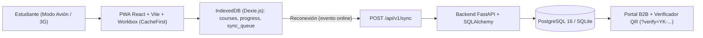
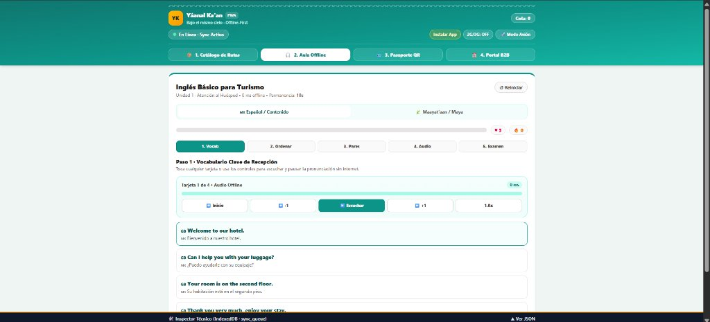
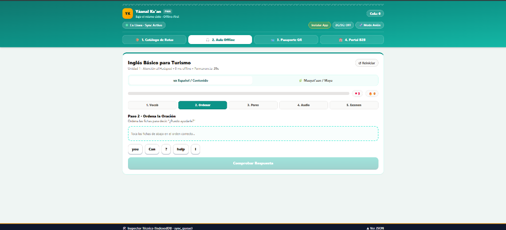
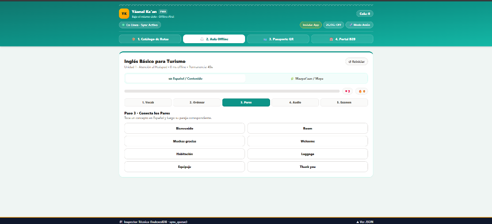
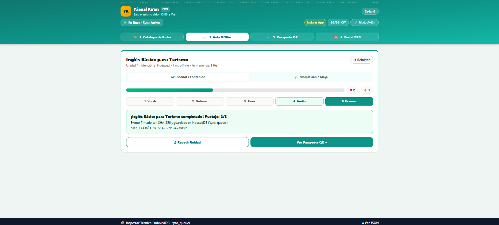
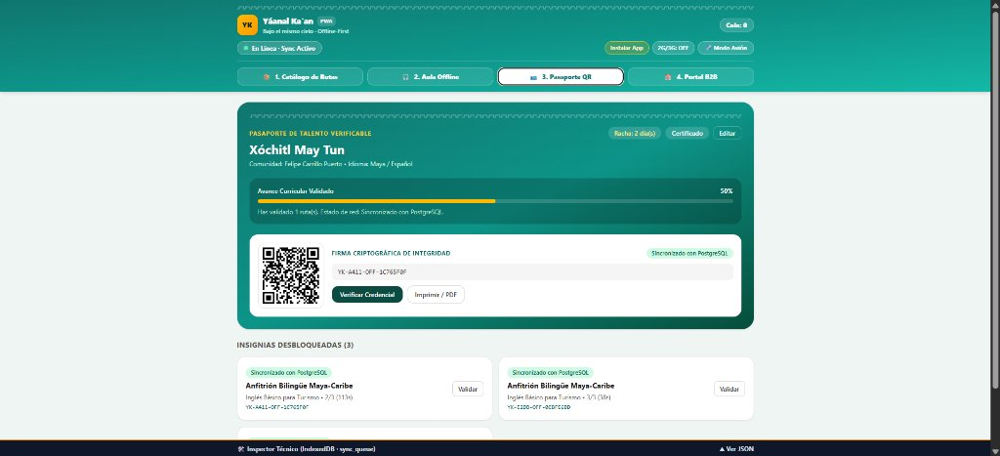
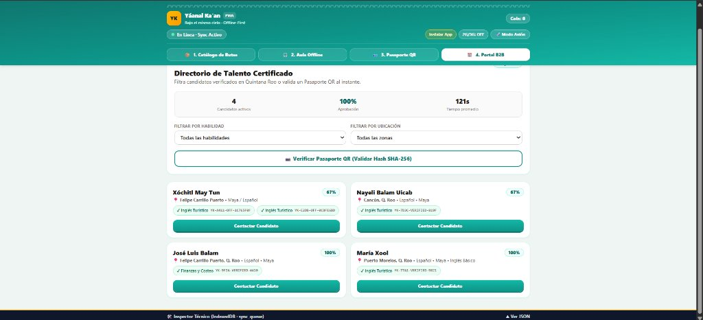

# HackMaya — Yáanal Ka’an (PWA Offline-First y Pasaporte de Talento)

> *"Conectando el talento local con oportunidades globales, incluso sin internet."*

**Yáanal Ka’an** (*"Bajo el mismo cielo"*) es una plataforma educativa y de vinculación laboral diseñada bajo una arquitectura **Offline-First** para el **Hack Maya (DevFest Cancún 2026)**, dentro de la línea temática **06. Educación y talento** *(con impacto transversal en 04. Comunidades y 07. Economía regional)*.

### ¿Qué problema resuelve?
En comunidades rurales y semiurbanas de la región Maya, la intermitencia de conectividad, el consumo excesivo de datos de las plataformas tradicionales, la falta de certificaciones prácticas y la barrera lingüística limitan el acceso a capacitación y empleo formal.

### Solución
Yáanal Ka’an permite descargar paquetes ligeros de micro-aprendizaje en puntos con Wi-Fi público para estudiar **100% sin conexión** en **Español y Maayat'aan (Maya)**, validar competencias mediante un **Pasaporte de Talento con QR verificable** (sincronizado automáticamente al recuperar señal) y conectar directamente a egresados con empresas, hoteles y cooperativas locales en el **Portal B2B** — manteniendo acceso **100% gratuito para estudiantes** y sostenibilidad vía suscripciones **B2B** y licenciamiento **B2G / ONGs**.

## Arquitectura Offline-First



## Stack Tecnológico

- **Frontend (PWA Offline-First):** React 19 + TypeScript + Vite + TailwindCSS + `vite-plugin-pwa` (Workbox con `CacheFirst` para assets estáticos y precacheo total de rutas).
- **Persistencia Local:** `Dexie.js` sobre `IndexedDB` (`courses`, `progress`, `sync_queue`, `student_profile`) con evaluación offline, firma SHA-256, tiempo de permanencia y lectura en voz alta (`window.speechSynthesis` ES/EN).
- **Backend API:** Python + FastAPI + Uvicorn + Pydantic + SQLAlchemy 2.
- **Base de Datos:** PostgreSQL 16 (mediante `DATABASE_URL` y `docker-compose.yml`) con fallback automático a SQLite local (`yaanal_kaan.db`).

## Las 4 Vistas Core

1. **1. Rutas (`CourseCatalog.tsx`):** Descarga de paquetes ligeros (*Inglés Básico para Turismo* y *Finanzas para Artesanos*), barra comparativa de ahorro de datos (`-100% MB` vs video), almacenamiento local, `Delta Sync` y liberación de espacio tras aprobar.
2. **2. Aula Offline (`OfflineClassroom.tsx`):** Selector **Español / Maayat'aan**, HUD con vidas y racha, 5 dinámicas interactivas (*Vocab con reproductor offline*, *Ordenar*, *Pares*, *Audio normal/lento* y *Examen*), cronómetro de permanencia y guardado en `sync_queue` con firma SHA-256.
3. **3. Pasaporte (`TalentPassport.tsx`):** Perfil editable, racha de estudio, barra de avance curricular, código QR con enlace verificable (`?verify=YK-...`), exportación imprimible a PDF (`Imprimir / PDF`) y validación contra `GET /api/v1/verify/{validation_hash}`.
4. **4. Portal B2B (`RecruiterPortal.tsx`):** Directorio de talento certificado filtrable por habilidad y comunidad, métricas de tracción (`/api/v1/analytics`), verificador QR (`Verificar Pasaporte QR`) e invitación a entrevista.

Además incluye **Modo Ahorro 2G/3G**, botón **Modo Avión** y un **Inspector Técnico (`IndexedDB · sync_queue`)** para auditar la cola offline en vivo.

## Capturas de la Aplicación

### 1. Catálogo de Rutas y Ahorro de Datos (`1. Catálogo de Rutas`)


### 2. Aula Offline Bilingüe en 5 Pasos (`2. Aula Offline`)





### 3. Pasaporte de Talento Verificable por QR (`3. Pasaporte QR`)


### 4. Portal B2B para Reclutadores (`4. Portal B2B`)


## Endpoints de la API (`FastAPI`)

| Método | Ruta | Descripción |
| :--- | :--- | :--- |
| `GET` | `/api/v1/health` | Estado del servicio y motor de base de datos activo (`postgresql` / `sqlite`). |
| `GET` | `/api/v1/courses` | Catálogo de paquetes educativos ligeros listos para guardar en `IndexedDB`. |
| `GET` | `/api/v1/courses/{course_id}` | Detalle individual de una ruta educativa. |
| `POST` | `/api/v1/sync` | Sincronización en lote idempotente desde `sync_queue` por `validation_hash`. |
| `GET` | `/api/v1/candidates` | Directorio B2B con filtros opcionales `community` y `skill`. |
| `GET` | `/api/v1/verify/{validation_hash}` | Verificación pública de autenticidad de credencial / código QR. |
| `GET` | `/api/v1/analytics` | Métricas agregadas de candidatos, tasa de aprobación y tiempos promedio. |

## Puesta en Marcha Rápida

### Opción A: Backend con SQLite (cero dependencias externas)
```powershell
cd backend
python -m venv .venv
.\.venv\Scripts\Activate.ps1
pip install -r requirements.txt
uvicorn app.main:app --reload --port 8000
```

### Opción B: Backend conectado a PostgreSQL (Docker)
```powershell
docker compose up -d postgres
Copy-Item backend\.env.example backend\.env
cd backend
.\.venv\Scripts\uvicorn.exe app.main:app --reload --port 8000
```

### Frontend PWA
```powershell
cd frontend
npm install
npm run dev
```
Para probar el Service Worker en modo producción offline completo:
```powershell
cd frontend
npm run build
npm run preview
```

### Pruebas Automatizadas (Backend)
```powershell
cd backend
pip install -r requirements-dev.txt
pytest -v
```

## Documentación Técnica
- [Propuesta Técnica y Arquitectura](docs/PROPUESTA_TECNICA.md)
