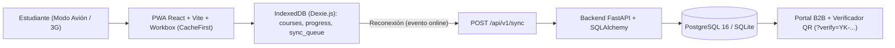
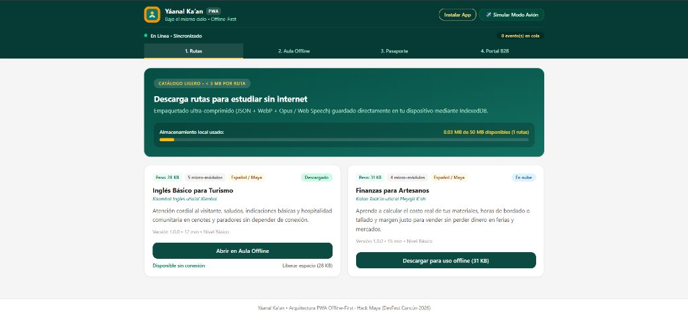
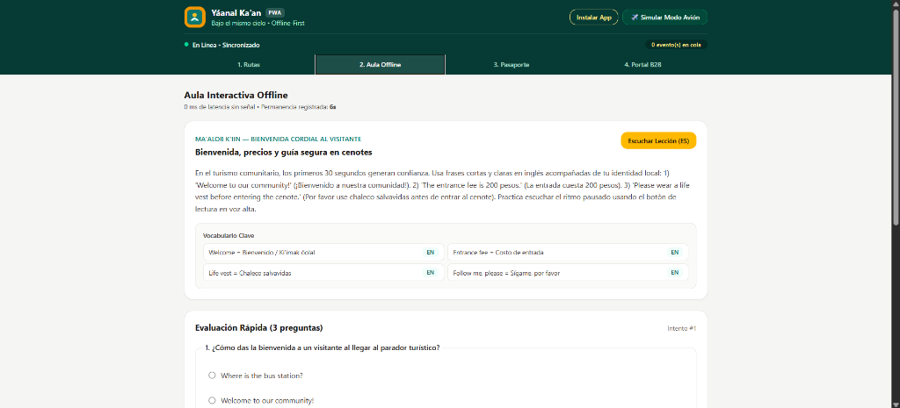
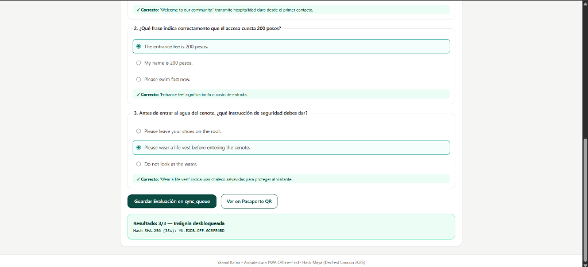
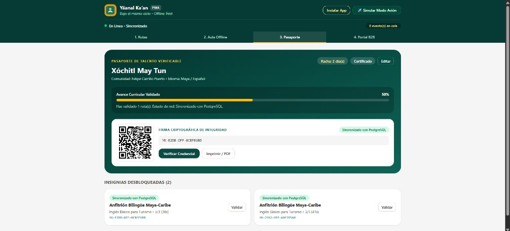
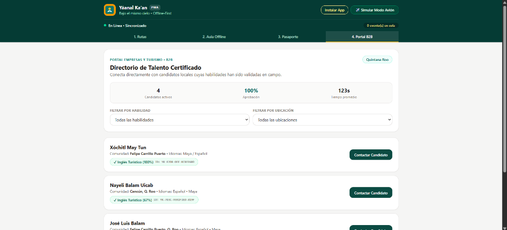

# HackMaya — Yáanal Ka’an (PWA Offline-First y Pasaporte de Talento)

Proyecto desarrollado para **Hack Maya (DevFest Cancún 2026)** bajo la línea temática **06. Educación y talento** (aprendizaje, empleabilidad y brecha digital).

## Arquitectura Offline-First



## Stack Tecnológico

- **Frontend (PWA Offline-First):** React 19 + TypeScript + Vite + TailwindCSS + `vite-plugin-pwa` (Workbox con `CacheFirst` para assets estáticos y precacheo total de rutas).
- **Persistencia Local:** `Dexie.js` sobre `IndexedDB` (`courses`, `progress`, `sync_queue`, `student_profile`) con evaluación offline, firma SHA-256, tiempo de permanencia y lectura en voz alta (`window.speechSynthesis` ES/EN).
- **Backend API:** Python + FastAPI + Uvicorn + Pydantic + SQLAlchemy 2.
- **Base de Datos:** PostgreSQL 16 (mediante `DATABASE_URL` y `docker-compose.yml`) con fallback automático a SQLite local (`yaanal_kaan.db`).

## Las 4 Vistas Core

1. **1. Rutas (`CourseCatalog.tsx`):** Descarga de paquetes ligeros (*Inglés Básico para Turismo* y *Finanzas para Artesanos*), barra de almacenamiento local, indicador de versión (`Delta Sync`) y liberación de espacio tras aprobar.
2. **2. Aula Offline (`OfflineClassroom.tsx`):** Lección bilingüe, audio nativo en español y pronunciación en inglés por frase, cronómetro de permanencia e intentos, evaluación de 3 preguntas con retroalimentación y guardado en `sync_queue`.
3. **3. Pasaporte (`TalentPassport.tsx`):** Perfil editable, racha de estudio, barra de avance curricular, código QR con enlace verificable (`?verify=YK-...`), exportación imprimible a PDF (`Imprimir / PDF`) y validación contra `GET /api/v1/verify/{validation_hash}`.
4. **4. Portal B2B (`RecruiterPortal.tsx`):** Directorio de talento certificado filtrable por habilidad y comunidad, métricas de tracción (`/api/v1/analytics`) e invitación a entrevista.

## Capturas de la Aplicación

### 1. Catálogo y Almacenamiento Offline (`1. Rutas`)


### 2. Aula Offline con Lectura Dual ES/EN y Evaluación SHA-256



### 3. Pasaporte de Talento Verificable por QR


### 4. Portal B2B para Reclutadores


## Endpoints de la API (`FastAPI`)

| Método | Ruta | Descripción |
| :--- | :--- | :--- |
| `GET` | `/api/v1/health` | Estado del servicio y motor de base de datos activo (`postgresql` / `sqlite`). |
| `GET` | `/api/v1/courses` | Catálogo de paquetes educativos ligeros listos para guardar en `IndexedDB`. |
| `GET` | `/api/v1/courses/{course_id}` | Detalle individual de una ruta educativa. |
| `POST` | `/api/v1/sync` | Sincronización en lote idempotente desde `sync_queue` por `validation_hash`. |
| `GET` | `/api/v1/candidates` | Directorio B2B con filtros opcionales `community` y `skill`. |
| `GET` | `/api/v1/verify/{validation_hash}` | Verificación pública de autenticidad de credencial / código QR. |
| `GET` | `/api/v1/analytics` | Métricas agregadas de candidatos, tasa de aprobación y tiempos promedio. |

## Puesta en Marcha Rápida

### Opción A: Backend con SQLite (cero dependencias externas)
```powershell
cd backend
python -m venv .venv
.\.venv\Scripts\Activate.ps1
pip install -r requirements.txt
uvicorn app.main:app --reload --port 8000
```

### Opción B: Backend conectado a PostgreSQL (Docker)
```powershell
docker compose up -d postgres
Copy-Item backend\.env.example backend\.env
cd backend
.\.venv\Scripts\uvicorn.exe app.main:app --reload --port 8000
```

### Frontend PWA
```powershell
cd frontend
npm install
npm run dev
```
Para probar el Service Worker en modo producción offline completo:
```powershell
cd frontend
npm run build
npm run preview
```

### Pruebas Automatizadas (Backend)
```powershell
cd backend
pip install -r requirements-dev.txt
pytest -v
```

## Documentación Técnica
- [Propuesta Técnica y Arquitectura](docs/PROPUESTA_TECNICA.md)
